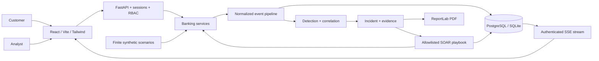

# BankGuard SOC

**Real-World Banking Fraud Defense — End to End**

An interactive, synthetic retail-banking security lab. Launch a phishing-driven account takeover, watch the internal SIEM correlate telemetry, investigate the resulting incident, verify SOAR containment and download the incident report.

**This is an educational simulator. No real banks, credentials, victims, payments, phishing delivery or malicious infrastructure are involved.**

## Quick start: Docker

Install Docker Desktop (with Linux containers) or Docker Engine and Compose. From the project root:

```bash
docker compose up --build
```

Open **http://localhost:8080**. Initial image downloads may take several minutes. The backend applies Alembic migrations and seeds the baseline automatically. PostgreSQL and the backend are private to the Compose network; only the web interface is published, on loopback.

```bash
docker compose ps
docker compose logs -f backend
docker compose down
```

`down` preserves the database volume. Use the confirmed reset action in the application to restore the lab.

## Demo credentials

These are intentionally public **synthetic demo** credentials, configurable using `.env`.

| Role | Email | Password |
|---|---|---|
| SOC analyst | analyst@bankguard.test | Analyst-demo-123! |
| Administrator | admin@bankguard.test | Admin-demo-123! |
| Customer | customer@bankguard.test | Customer-demo-123! |

Customer **Rahul Sharma / BG1001 / BG-SAV-1001** starts with **INR 250,000**, two trusted devices, beneficiaries and transaction history. Other customers have randomly generated, undisclosed passwords. The primary attack really changes Rahul's synthetic password; reset restores the documented credentials.

Administrators can reset, configure rules, enable/disable scenarios and manage users. Analysts can launch scenarios, investigate and run responses. Customers can access only their own banking records. **Reset revokes existing authenticated sessions**, so sign in again afterward.

## Demo walkthrough

1. Sign in as analyst and choose **Start Guided Simulation** on Overview.
2. Keep the full-chain scenario selected. Click **Launch Simulation**.
3. Click **Continue** through the eight lessons: phishing, suspicious login, device review, password change, beneficiary, transfer, correlation and response.
4. Observe the score rising from 10 to 55, 65, 80 and finally **110**. A HIGH incident opens at 65; the transfer upgrades it to CRITICAL.
5. BankGuard evaluates before settlement. The SOAR playbook locks the account, revokes customer sessions, freezes the INR 150,000 transfer and blocks the test IP.
6. Choose **View Investigation**. Explore the timeline, evidence hashes, risk factors, IP intelligence, response results and investigation workspace.
7. Assign the incident to yourself, add a note, update status to Remediating and then Resolved. Download a PDF report.
8. Sign in as admin. Open Attack Scenarios → **Reset Demo Environment** → **Confirm Reset**.
9. Try **False positive · New device** after reset. It creates a MEDIUM alert with only 15 aggregate risk points and does not lock the account.

For automatic playback, uncheck guided mode. Pause, resume and stop are supported. A second browser tab on Live Events updates through SSE without a refresh. A stopped run retains its evidence and effects; it does not silently undo security controls. Reset before repeating attacks against a contained account or blocked IP.

## Architecture

**React + TypeScript + FastAPI + PostgreSQL + internal SIEM + internal SOAR**, organized as a modular monolith.



Read [architecture](docs/architecture.md), [database](docs/database.md), [SIEM](docs/siem.md), [SOAR](docs/soar.md) and [API](docs/api.md) for the implementation details.

## Features

- Responsive dark SOC interface with accessible controls, Radix dialogs, Lucide icons, searchable navigation and lazy-loaded routes.
- Customer balance/available balance, transaction history, beneficiary creation, simulated transfers and password changes.
- Searchable, paginated SIEM events with severity, event type, customer, IP and time filters; raw event inspector; guided hunting queries.
- Eleven configurable detections, deduplicated time-window risk scores and automatic incident grouping.
- Seven scenarios, eight-step guided ATO narrative, automatic playback and controls.
- Nine incident tabs: Overview, Timeline, Evidence, Events, Risk Analysis, Threat Intel, Response, Investigation and Report.
- Own-note editing/deletion, evidence snapshots with SHA-256 hashes, analyst assignment and controlled status transitions.
- Nine allowlisted SOAR actions with mode, status, timing, result and failure records.
- Database-driven dashboard charts, response histories, reports, audit logs, user management and health checks.
- PDF download and printable report preview, with executive summary, timeline, evidence, risk, response, impact and recommendations.
- Baseline: 12 customers, 12 accounts, 24+ devices, 120+ baseline security events, 60 baseline transfers and two complete prepared ATO incidents generated by the actual engine.

## Technology stack

Frontend: React 19, strict TypeScript, Vite, Tailwind CSS 4, Radix/shadcn-style UI primitives, React Router, TanStack Query, Recharts and Lucide. Backend: Python 3.13, FastAPI, Pydantic, SQLAlchemy 2, Alembic, Argon2 and ReportLab. Infrastructure: PostgreSQL 17, Docker Compose and unprivileged Nginx. Verification: Pytest, Playwright, Ruff, TypeScript, ESLint, npm audit and pip-audit.

No OpenSearch, Redis, Shuffle, paid API or cloud account is required. Event search and aggregation use the relational database.

## Local setup without Docker

Requirements: Python 3.13+, Node 22.14+ and npm. Run at the repository root:

```bash
python -m venv .venv
# Linux/macOS
source .venv/bin/activate
# Windows PowerShell alternative
# .\.venv\Scripts\Activate.ps1
python -m pip install -r backend/requirements-lock.txt
cp .env.example .env
# PowerShell alternative: Copy-Item .env.example .env
cd backend
python -m alembic upgrade head
python -m uvicorn app.main:app --host 127.0.0.1 --port 8000
```

In a second terminal:

```bash
cd frontend
npm ci
npm run dev
```

Open **http://localhost:5173**. Vite proxies `/api` to port 8000. SQLite is the default local database and is created under `backend/`; use `DATABASE_URL=postgresql+psycopg://...` for PostgreSQL. Do not use the development server as an internet-facing host. Opaque sessions are stored server-side, so no JWT signing secret is required.

Alternatively, `python scripts/manage.py install`, `python scripts/manage.py dev`, `python scripts/manage.py test` provide cross-platform convenience commands. Run them using the virtual environment's Python. Development runs the frontend and backend together and shuts down child processes on Ctrl+C.

## Security model

Passwords are Argon2 hashes. A cryptographically random opaque session token is stored only in an HttpOnly, SameSite=Strict cookie; only its SHA-256 digest is persisted. Sessions expire and are checked against the database on every request. Mutations require the session-bound CSRF token. Cross-origin mutations are checked, inputs are typed and bounded, and database operations use SQLAlchemy expressions. The browser stores no authentication token in localStorage/sessionStorage.

Privileged actions generate audit records. Reset preserves audit history. The UI renders user content as text, and Nginx supplies a restrictive CSP. Authentication is rate limited. The simulation accepts no arbitrary scripts, target URLs or real credentials and makes no outbound attack calls. See [threat model](docs/threat-model.md).

Production mode requires HTTPS origins and replacement of the public demo passwords. It sets Secure cookies. This is still an educational application, not a real-bank control system.

## Detection engineering and risk scoring

The default correlation window is 15 minutes. Distinct enabled rules contribute once per customer/account/window. Simulation runs are isolated so a focused false-positive exercise does not inherit another run's risk. Routine customer API activity correlates in the ordinary, non-run event stream.

| Signal | Default points |
|---|---:|
| New device | 15 |
| Unusual country | 20 |
| Impossible travel | 30 |
| Password change after suspicious login | 10 |
| New beneficiary | 15 |
| Large transfer (INR 100,000+) | 30 |
| Repeated failed logins | 10 |
| Phishing credential interaction | 10 |
| Malicious local IP reputation | 10 |

The full-chain scenario totals **110**. The teaching weights deliberately keep the critical crossing at the attempted transfer. Defaults: LOW 0–29, MEDIUM 30–59, HIGH 60–89 and CRITICAL 90+. A standalone new-device rule has MEDIUM **alert severity** but only 15 **aggregate risk**; these are different concepts. Administrators can configure thresholds, weights and supported windows. Extreme tuning can cause earlier containment and safely interrupt later attack steps. See [detection engineering](docs/detection-engineering.md).

## SIEM, SOAR and incident response

The SIEM normalizes and indexes banking events, evaluates rules, creates alerts, correlates incidents and captures evidence. The SOAR engine executes a finite allowlist in the same transaction as critical detection, before a transfer can settle. Actions use savepoints, retain failures and record execution mode. Already successful executions are idempotent. A failed execution can be retried after remediation; individual actions are state-setting operations.

Incident lifecycle: NEW → TRIAGED → INVESTIGATING → REMEDIATING → RESOLVED → CLOSED. Successful containment sets CONTAINED, from which analysts can investigate, remediate or resolve. Closure does **not** unlock the account or release frozen funds. Reset is the only lab-wide recovery control. See [incident response](docs/incident-response.md).

## API documentation

- Swagger UI: http://localhost:8080/api/docs
- ReDoc: http://localhost:8080/api/redoc
- OpenAPI JSON: http://localhost:8080/api/openapi.json
- Backend probes: `/health`, `/ready` (inside the Compose network; port 8000 in local development).

Swagger/ReDoc load their presentation assets from a CDN; the application itself is self-hosted. Authenticate through the app or the login endpoint, then include the returned `csrf_token` as `X-CSRF-Token` on mutation requests. Read [API usage](docs/api.md) for scripts and examples.

## Testing

```bash
# Backend: isolated in-memory SQLite, never your running demo database
cd backend
python -m pytest -q
python -m ruff check .

# Frontend and browser integration
cd ../frontend
npm run lint
npm run build
npx playwright install chromium
npm test
```

Playwright targets the running Compose app at port 8080. Override `BASE_URL` to test a different local endpoint. **E2E tests reset the synthetic environment**, use the public demo credentials and should be run against an isolated lab. They cover analyst login, guided ATO, live streaming into another tab, controls, containment states, evidence, notes, PDF download, resolution, reset, customer transfer and all required responsive widths. Screenshots and PDFs are written to `artifacts/`; traces are retained on failure. The source ZIP excludes these generated files.

```bash
npm audit --prefix frontend
python -m pip install pip-audit
python -m pip_audit -r backend/requirements-lock.txt
```

See `BUILD_STATUS.md` for the actual verification record for this build. CI repeats lint, tests, audits and Docker/browser validation.

## Configuration and deployment

`.env.example` documents the local variables. Compose supplies public demo defaults so the one-command demo works without an `.env`. For any shared deployment, replace those values and use the production override behind an HTTPS terminator:

```bash
docker compose -f docker-compose.yml -f infrastructure/deployment/compose.production.yml up --build -d
```

The production override validates required configuration and removes unnecessary Linux capabilities. It does not provision TLS, domains, cloud accounts or a secret manager. The same containers can run on a Linux VM in AWS, Azure, GCP or any other provider. See [deployment](docs/deployment.md).

## Troubleshooting

| Symptom | Resolution |
|---|---|
| Docker cannot connect | Start Docker Desktop and select Linux containers. |
| Web UI is unavailable initially | Wait for `docker compose ps` to show all services healthy; inspect backend logs. |
| Login after an attack fails | The synthetic password was changed and sessions revoked. Sign in as admin and reset the lab. |
| Scenario returns 409 or 423 | Stop the existing run, or reset a locked account / blocked test IP. |
| CSRF error | Reload or sign in again to obtain the current session-bound token. |
| 429 after repeated login attempts | Wait one minute; authentication is intentionally rate limited. |
| No tables in local mode | Run `alembic upgrade head` from `backend/`. |
| Cookie disappears in production | Use HTTPS. Secure cookies will not work on ordinary HTTP. |
| Events stop updating | Check the live indicator, sign in again if expired, and disable proxy response buffering for SSE. |
| Port 8080 already used | Change the published port and add the corresponding origin to `CORS_ORIGINS`. |

## Production considerations, limitations and future improvements

Run **one backend worker**. The mutation lock, simulation scheduler and rate limiter are process-local; a production-scale system needs a durable queue, distributed locks/rate limiting and cross-worker event fan-out. PostgreSQL is the preferred persistent database; SQLite supports local learning only. The SSE feed is a database-revision notification stream, with the event explorer as durable history, rather than a guaranteed-delivery message broker.

IP blocking and reputation are simulated database state. Notifications are internal SOC records; there is no external email delivery. Geolocation is a fictional country/city baseline and impossible-travel is a country/time heuristic, not geodesic analytics. Evidence hashes detect changed snapshots but are not digitally signed chain-of-custody guarantees. Money is integer paise, with no external settlement or multi-currency accounting. Seed transactions are a synthetic historical snapshot, not a reconstructed financial ledger. There is no real MFA enrollment, account recovery, SSO or regulatory certification.

Future extensions: durable workflow scheduling, real-time per-action fan-out, saved analyst hunts, multi-tenant isolation, a double-entry simulated ledger, tamper-evident audit storage, richer geolocation fixtures and fully offline Swagger assets. Any real banking integration would need independent security engineering, legal/compliance review, authorization, operational controls and substantial redesign of the simulation boundaries.

## Repository and license

`frontend/` holds React; `backend/app/` separates banking, SIEM, detection, simulation, SOAR, investigation and report concerns; `database/` holds frozen migrations and seed entry points; `simulator/` provides safe CLI tools; `infrastructure/` holds containers and deployment settings; `docs/` explains the design; `scripts/` supports development and clean ZIP export.

MIT licensed. Dependency licenses remain with their authors.
