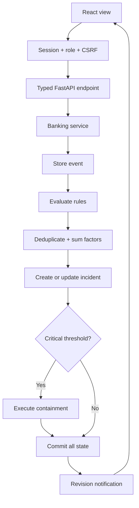
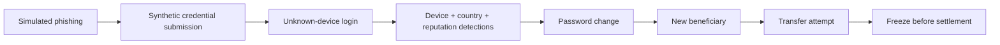

# Architecture and data flow

BankGuard is a modular monolith with a React client. FastAPI owns all banking, detection, risk, correlation and response decisions. PostgreSQL is both the application database and internal SIEM store. SQLite uses the same ORM model for simple development and isolated tests.

## Request and transaction boundary

1. Authentication resolves an opaque session digest and verifies expiry, enabled user and role.
2. Mutations verify CSRF and origin, then use a serialized database session.
3. Banking services lock the account row, validate ownership and funds, and create normalized telemetry.
4. Detection evaluates persisted events and alert relationships.
5. High risk creates an incident; critical risk executes the response allowlist before settlement.
6. The transaction commits. An authenticated SSE subscriber receives a revision change and the React Query cache refreshes the affected views.

## Attack flow

## Process model

One Uvicorn worker hosts APIs plus a daemon thread that advances non-guided simulations every configured interval. Each step persists its cursor and status. On restart, RUNNING runs become PAUSED to avoid replaying an uncertain step. Guided steps advance by authenticated API calls. The same mutation lock covers reset and worker advancement. The database provides durable state; the worker and limiter are intentionally process-local.

The SSE feed rechecks session authorization and polls database event/audit revision timestamps every 500 ms. Connections heartbeat and reconnect through EventSource. A revision invalidates cached queries; persistent event search provides history. Responses are not buffered by Nginx. SSE notifications arrive after committed transactions; actions within one atomic containment execution can arrive together.

## Main modules

| Module | Responsibility |
|---|---|
| `core` | Settings, connections, sessions, role dependencies |
| `models` / `schemas` | Relational data and bounded API inputs |
| `services/banking.py` | Ownership, balances, beneficiaries and transfers |
| `siem/events.py` | Normalized event storage and incident evidence links |
| `detection/engine.py` | Rules, correlation, risk and incident creation |
| `simulation` | Finite scenario definitions, lessons and progression |
| `soar/engine.py` | Allowlisted containment actions and execution ledger |
| `reports/generator.py` | Snapshot reports and PDF rendering |
| `api/investigation.py` | Investigation workspace, notes, evidence and lifecycle |

There is no external bank or attacker connection. The only optional external browser fetches are documentation presentation assets.
