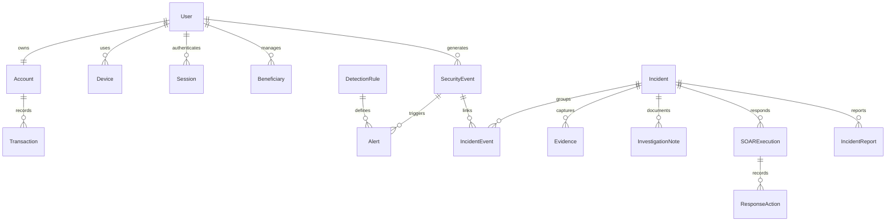

# Database schema

The ORM schema is `backend/app/models/entities.py`; the frozen initial DDL is `database/migrations/versions/0001_initial.py`. Apply migrations with `alembic upgrade head` from `backend/`. New changes should create new revisions; never regenerate a revision used by a deployment.

Every entity has a UUID primary key and an indexed creation timestamp. Timestamps are stored as timezone-naive **UTC** for consistent PostgreSQL/SQLite behavior, then serialized with an explicit UTC offset. Browser timestamps are localized for display. Money is positive integer paise with a nonnegative account balance constraint.

| Table | Purpose / key relationships |
|---|---|
| users | Role-constrained identities, unique emails/customer IDs, Argon2 hashes |
| accounts | One account per customer, unique account number, balance, ACTIVE/LOCKED |
| devices | Customer device inventory, unique per-user fingerprint, trust flag |
| sessions | User/device, unique token digest, CSRF token, expiry and revocation |
| login_events | One-to-one normalized event reference and authentication result |
| security_events | User/account/device/run, type, severity, IP, location and JSON metadata |
| beneficiaries | Unique customer/account-number pair |
| transactions | Account/payee/run, integer amount and constrained settlement status |
| detection_rules | Unique rule key, numeric settings, weight and counters |
| alerts | Source event/rule/user/incident, reason and severity; event-rule uniqueness |
| risk_scores | One evaluation per source event, score, level and factor snapshot |
| incidents | Customer/account, severity, risk, reason snapshot, analyst, run and lifecycle |
| incident_events | Unique incident-event association |
| soar_playbooks | Name, enabled status and ordered allowlisted actions |
| soar_executions | Incident/playbook, mode, status and completion |
| response_actions | Execution/incident, action, result/error and timestamps |
| threat_intel | Unique reserved IP, reputation, confidence, tags and block/watchlist status |
| investigation_notes | Incident, author, content and update time |
| evidence | Incident, type/title/source, canonical JSON snapshot and SHA-256 |
| audit_logs | Actor/action/resource/result/IP; retained across demo reset |
| simulation_scenarios | Unique slug, finite step list, enabled flag |
| simulation_runs | Scenario/customer/actor, progress cursor, status and incident navigation reference |
| incident_reports | Incident report sections and status snapshot |

Most relationships are enforced with foreign keys. The run's incident navigation ID is a denormalized nullable pointer; `Incident.run_id` is the enforced relationship. It avoids a cyclic creation/deletion dependency. Services populate both together.

Indexes support event user/time, IP, type, severity and run; incident status/account/user/run; response and evidence incident lookup. Foreign keys are enabled explicitly on SQLite connections. Reset deletes child records in dependency order inside the serialized transaction, reseeds the baseline and retains audit logs.
