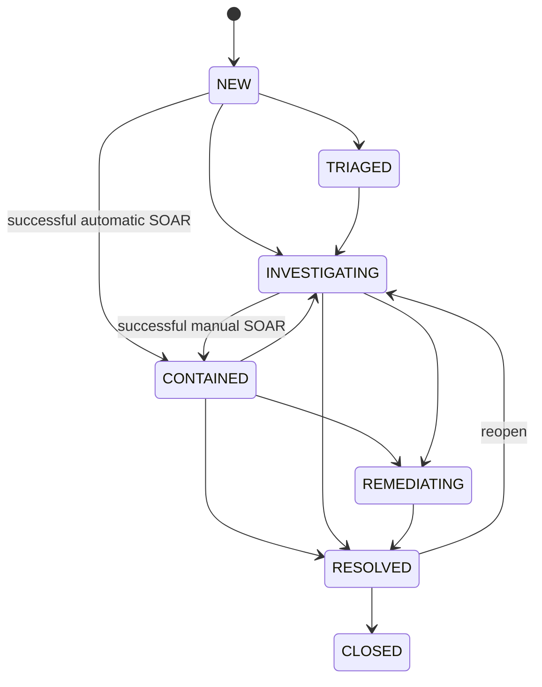

# Incident response workflow

The engine can contain any active incident after successful execution. Analysts cannot simply set CONTAINED in the status selector; that status should reflect executed controls. The API enforces the lifecycle and rejects illegal transitions. Closing a case does not release held funds or unlock accounts.

## Investigation checklist

1. Confirm the affected customer, account, source IP and device.
2. Read “Why this incident exists.” Review each rule's supporting event.
3. Follow the chronological timeline and inspect structured event metadata.
4. Inspect transaction, IP, device and event evidence. Compare the SHA-256 snapshot hash when exporting evidence.
5. Confirm actual account, session, transaction and IP state in the workspace.
6. Check response mode, action result, failure details and timestamps.
7. Assign yourself, write findings and document uncertainties. Only note authors may edit/delete their notes; the original captured snapshot remains evidence.
8. Record remediation and resolve. Generate the PDF after your final changes so it contains the latest status.

Screenshot evidence is a textual reference; files are not uploaded or fetched. All notes render as text. Reports escape text before PDF layout. New PDF generations create distinct snapshots and audit entries.

Reset is an administrator-only lab recovery function requiring the literal confirmation `RESET BANKGUARD`. It is serialized against active worker steps, terminates runs, clears generated records and restores the seeded baseline. It preserves audit logs and invalidates old authenticated sessions. No real financial recovery process is represented.
