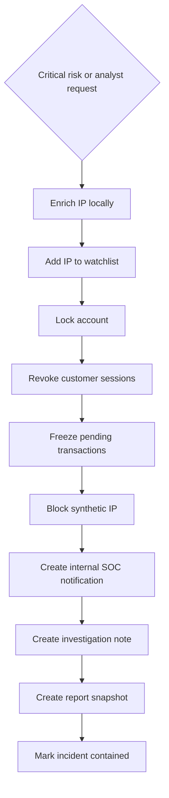

# Built-in SOAR

Security Orchestration, Automation and Response executes a controlled playbook after critical correlation or an analyst's manual decision. It is a Python service, not a shell runner or workflow that can accept arbitrary browser code.

Actions are exactly `ENRICH_IP`, `ADD_IP_TO_WATCHLIST`, `LOCK_ACCOUNT`, `REVOKE_SESSION`, `FREEZE_TRANSACTION`, `BLOCK_IP`, `NOTIFY_SOC`, `CREATE_INVESTIGATION_NOTE`, `CREATE_INCIDENT_REPORT`.

`SOARExecution` stores incident, playbook, mode, status, creation/start time and completion time. `ResponseAction` stores each action's status, creation/start and completion timestamps, structured result and error. Privileged actions also create audit entries. Action savepoints prevent partial failed actions from committing while retaining their failure record. Execution stops on failure; the incident is marked CONTAINED only on success.

State changes are real within the simulated bank: accounts become LOCKED, active customer sessions REVOKED, pending transfers FROZEN and the IP reputation record BLOCKED. Banking checks the account lock; synthetic login checks the simulated IP block. This does not configure the operating system firewall or contact external infrastructure.

A successful execution is idempotent for its incident. Repeating the request returns its ledger. Manual containment is allowed on open incidents; already settled transactions are not reversed or fabricated as frozen. The UI reports actual results and counts. An automatic report snapshot can show the in-progress state; generating a new report after containment produces the final status and full ledger.

Critical detection and containment commit atomically before settlement. The actions usually complete in milliseconds and can arrive together in the live UI; timestamps show actual execution time. Guided reading time is included in the displayed scenario duration.
